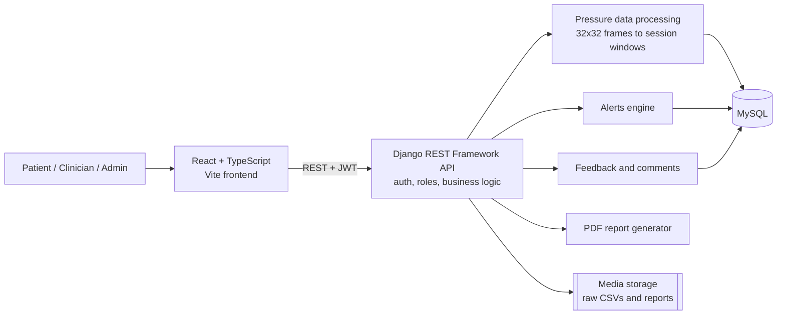

# Sensore: Pressure-Ulcer Monitoring Platform

A full-stack web application that turns real-time data from a **32×32 e-textile pressure-sensing mat** into live heat maps, clinical metrics, alerts and reports. It helps patients, clinicians and administrators prevent pressure ulcers, which cost the NHS about **£3.8 million a day**.

Built by a team of four for the *Advanced Web Solutions* module (MSc Computer Science, Anglia Ruskin University, April 2026) using the Graphene Trace case study.

> **My role (Nauman Patel):** authentication and role-based access control. See [My contribution](#my-contribution-authentication--role-based-access-control).

---

## Features

| Area | What it does |
|---|---|
| **Authentication** | JWT login with role selection, silent access-token refresh, logout, and forgot/reset password |
| **Role-based access** | Separate Admin, Clinician and Patient dashboards, enforced in both the API and the UI |
| **Admin tools** | Create and update users, assign patients to clinicians, upload pressure CSVs, view system statistics |
| **Live monitoring** | Real-time pressure heat map, Peak Pressure Index and Contact Area % |
| **Alerts** | Automatic flags for sustained high pressure, marked on a timeline |
| **Reports** | Session comparison, trend graphs over 1 h / 6 h / 24 h, and downloadable PDF reports |
| **Communication** | Threaded patient–clinician comments linked to timestamps |

## Architecture



**Data model:** `User` (with a role) → `PatientProfile`, `ClinicianPatientAssignment`, `PressureRawUpload` → `SessionWindow` → `Alert`, plus `FeedbackComment` for threaded messages.

## Tech stack

- **Frontend:** React 18, TypeScript, Vite, Tailwind CSS, Radix UI, Recharts, Axios
- **Backend:** Python, Django, Django REST Framework, Simple JWT, NumPy
- **Database:** MySQL (via PyMySQL)
- **Tooling:** Git and GitHub, VS Code

---

## My contribution: authentication & role-based access control

I owned seven user stories covering how users sign in and what each role is allowed to see:

1. **Secure login and logout.** `SecureTokenView` validates credentials and issues a JWT access/refresh pair. `ProtectedRoute.jsx` checks the token on every page load and silently refreshes it when it expires. `LogoutView` handles sign-out.
2. **Role assignment.** Every account is Admin, Clinician or Patient. The role is stored on a custom `User` model, embedded in the JWT by the serializer, and used to send each user to their own dashboard.
3. **Role-based access control.** Custom DRF permission classes (`permissions.py`) block unauthorised requests before they reach any business logic. The frontend's protected routes stop users from navigating outside their role.
4. **Admin account management.** `AccountCreation.tsx` and `AdminCreateUserView` let admins create and update patient and clinician accounts, with password hashing and email validation. Public self-registration is disabled.
5. **Patient–clinician assignment.** Admins link patients to clinicians through the `ClinicianPatientAssignment` model.
6. **Clinician view.** Querysets are filtered so a clinician only ever sees their assigned patients.
7. **Patient privacy.** Patients can only fetch their own data. Requesting another patient's data through the API returns **403 Forbidden**.

**Key files:** `backendservice/users/views.py`, `permissions.py`, `serializers.py`, `models.py`, `frontend/src/components/WelcomePage.tsx`, `ProtectedRoute.jsx`, `AccountCreation.tsx`, `App.tsx`

### Testing: all 13 cases passed

| # | Test | Result |
|---|---|---|
| 1–3 | Valid login, invalid password, logout | Pass |
| 4 | Open a dashboard without logging in → redirected to login | Pass |
| 5–6 | Patient opens the admin dashboard / clinician opens the patient dashboard → blocked | Pass |
| 7–9 | Admin creates a clinician, updates a patient, assigns a patient to a doctor | Pass |
| 10–11 | Doctor A sees only assigned patients; Doctor B cannot see Doctor A's patient | Pass |
| 12–13 | Patient sees only their own data; cross-patient API request returns 403 | Pass |

---

## Running locally

**Prerequisites:** Python 3.11+, Node.js 18+ and MySQL 8

### Backend

```bash
python -m venv venv
source venv/bin/activate          # Windows: venv\Scripts\activate
pip install -r requirements.txt

cd backendservice
cp .env.example .env              # then fill in your MySQL details and a secret key
python manage.py migrate
python manage.py createsuperuser
python manage.py runserver        # http://localhost:8000
```

### Frontend

```bash
cd frontend
npm install
npm run dev                       # http://localhost:5173
```

> The settings are for local development only (`DEBUG = True`, open CORS). Before deploying, restrict `ALLOWED_HOSTS` and CORS and set `DEBUG = False`.

**Data:** the pressure CSVs from the Graphene Trace case study are not included. Each CSV row is one 32×32 frame. Upload files through **Admin → Upload Pressure Data**.

## Team

| Member | Responsibility |
|---|---|
| **Nauman Patel** | Authentication & role management |
| Michael Nketia | Data storage, heat map & metrics |
| Anurag Deepak | Reports & historical comparison |
| Brinsley Demenez | Feedback system & alerts |

Original team repository: [MichaelAikinsJr/Sensore-Project](https://github.com/MichaelAikinsJr/Sensore-Project)
