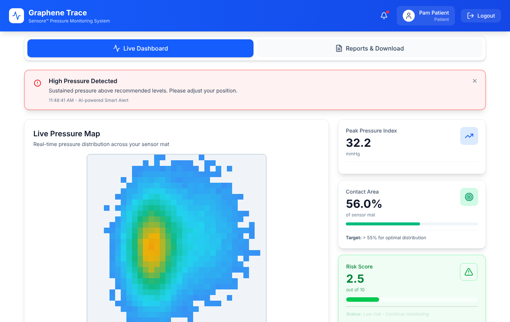
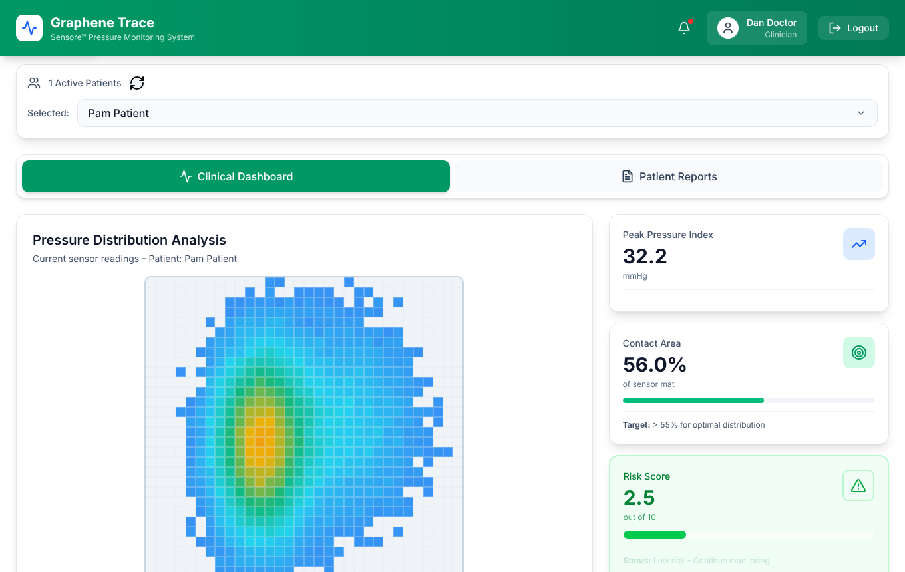
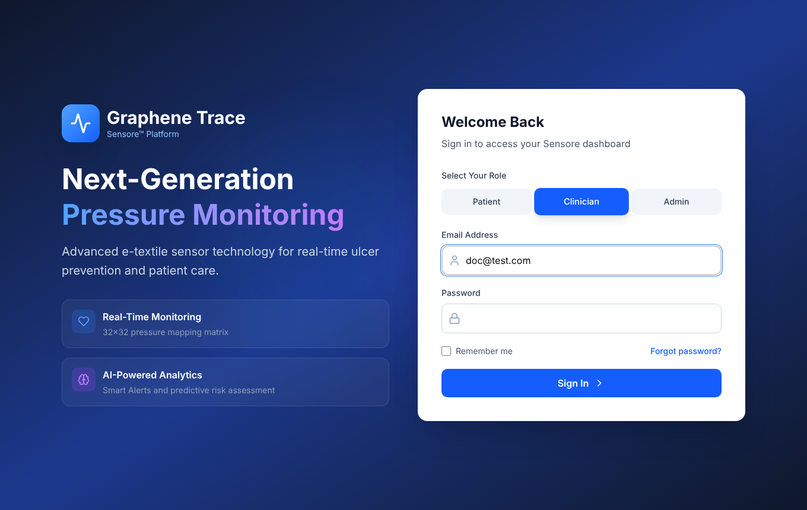
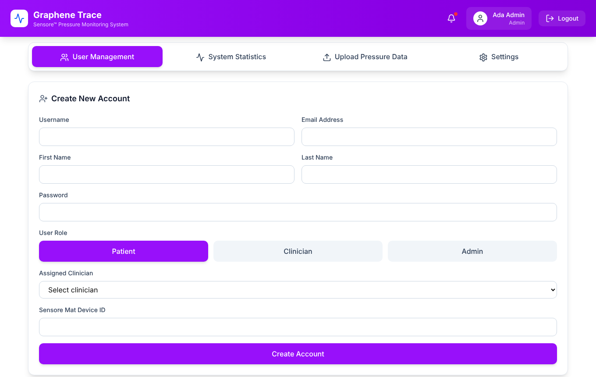
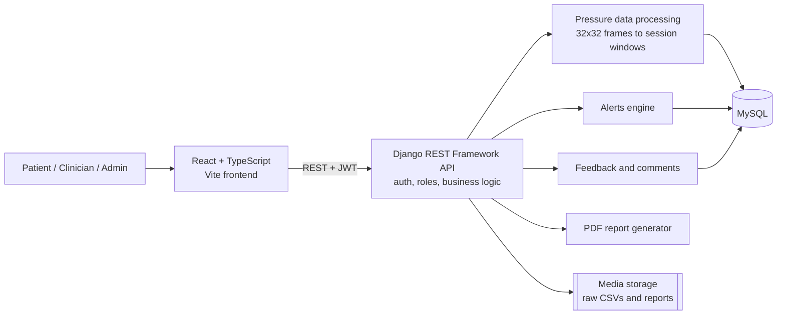

# Sensore: Pressure-Ulcer Monitoring Platform

A full-stack web application that turns real-time data from a **32×32 e-textile pressure-sensing mat** into live heat maps, clinical metrics, alerts and reports. It helps patients, clinicians and administrators prevent pressure ulcers, which cost the NHS about **£3.8 million a day**.

Built by a team of four for the *Advanced Web Solutions* module (MSc Computer Science, Anglia Ruskin University, April 2026) using the Graphene Trace case study.

> **My role (Nauman Patel):** authentication and role-based access control. See [My contribution](#my-contribution-authentication--role-based-access-control).

| Patient: live pressure map and alerts | Clinician: assigned patients only |
|---|---|
|  |  |
| **Role-based login** | **Admin: create accounts and assign clinicians** |
|  |  |

<sub>Screenshots use synthetic demo data, not real patient readings.</sub>

---

## Features

| Area | What it does |
|---|---|
| **Authentication** | JWT login with role selection, silent access-token refresh, logout, and forgot/reset password |
| **Role-based access** | Separate Admin, Clinician and Patient dashboards, enforced in both the API and the UI |
| **Admin tools** | Create and update users, assign patients to clinicians, upload pressure CSVs, view system statistics |
| **Live monitoring** | Real-time pressure heat map, Peak Pressure Index and Contact Area % |
| **Alerts** | Automatic flags for sustained high pressure, marked on a timeline |
| **Reports** | Session comparison, trend graphs over 1 h / 6 h / 24 h, and downloadable PDF reports |
| **Communication** | Threaded patient–clinician comments linked to timestamps |

## Architecture



**Data model:** `User` (with a role) → `PatientProfile`, `ClinicianPatientAssignment`, `PressureRawUpload` → `SessionWindow` → `Alert`, plus `FeedbackComment` for threaded messages.

## Tech stack

- **Frontend:** React 18, TypeScript, Vite, Tailwind CSS, Radix UI, Recharts, Axios
- **Backend:** Python, Django, Django REST Framework, Simple JWT, NumPy
- **Database:** MySQL (via PyMySQL)
- **Tooling:** Git and GitHub, VS Code

---

## My contribution: authentication & role-based access control

I owned seven user stories covering how users sign in and what each role is allowed to see:

1. **Secure login and logout.** `SecureTokenView` validates credentials and the selected role, then issues a JWT access/refresh pair. `ProtectedRoute.jsx` checks the token on every page load and silently refreshes it when it expires. On logout, the refresh token is **blacklisted** on the server so it cannot be reused.
2. **Role assignment.** Every account is Admin, Clinician or Patient. The role is stored on a custom `User` model, embedded in the JWT by the serializer, and used to send each user to their own dashboard.
3. **Role-based access control.** Custom DRF permission classes (`IsAdminRole`, `IsAdminOrClinician`, `IsClinicianOrPatient`) block unauthorised requests before they reach any business logic. A single `can_view_patient_data()` rule guards every clinical-data endpoint: heat maps, time series, alerts, comparisons and feedback. The frontend's protected routes add a second layer in the UI.
4. **Admin account management.** `AccountCreation.tsx` and `AdminCreateUserView` let admins create and update patient and clinician accounts, with hashed passwords and Django password validation. There is no public sign-up, so only admins can create accounts.
5. **Patient–clinician assignment.** When an admin creates a patient, they pick a clinician and a mat device ID. The patient's profile and their `ClinicianPatientAssignment` are created in one database transaction.
6. **Clinician view.** The patient list and every data endpoint are filtered by active assignment, so a clinician only ever sees their own patients. Admins manage the system but cannot read clinical data.
7. **Patient privacy.** Patients can only fetch their own data. Requesting another patient's data through the API returns **403 Forbidden**.

**Key files:** `backendservice/users/views.py`, `permissions.py`, `serializers.py`, `models.py`, `frontend/src/components/WelcomePage.tsx`, `ProtectedRoute.jsx`, `AccountCreation.tsx`, `App.tsx`

### Testing

The module's 13 manual test cases (login, logout, role redirects, account creation, assignment and data isolation) all passed. They are now backed by **23 automated API tests** in [`backendservice/users/tests.py`](backendservice/users/tests.py):

| Area | Examples |
|---|---|
| Authentication | correct, wrong-password and wrong-role login; a refresh token is rejected after logout; protected endpoints need a login |
| Account management | anonymous users and non-admins cannot create accounts; admins create patients with a clinician and device; password updates are hashed; only admins can list, update or delete users or upload data |
| Data isolation | a clinician sees only assigned patients; an unassigned clinician gets 403 on heat maps, series, alerts and feedback; a patient cannot fetch another patient's data; admins cannot read clinical data |

```bash
cd backendservice
python manage.py test users --settings=backendservice.settings_test   # uses in-memory SQLite, no MySQL needed
```

### Security hardening after the module

When I reviewed the merged team branch, I found that several endpoints had been opened up (`AllowAny`) while features were being integrated. The first commit in this repo is that original code. The second commit, `Harden authentication and role-based access control`, fixes it:

- Account-creation endpoints were public and accepted a `role` field, so anyone could create an admin account. They are now admin-only.
- Logout returned a 400 error and never revoked the token, because the `token_blacklist` app wasn't installed. Logout now blacklists the refresh token, and the frontend calls the endpoint.
- Patient lists, heat maps, time series and comparisons could be read without logging in, for any patient ID. They now require login and an assignment check.
- Any logged-in user could edit or delete any user, and a password change was saved as plain text. User management is now admin-only and passwords are hashed.
- The clinician chosen when creating a patient was silently dropped. Admin-created patients now get their assignment and device profile.

All 23 tests pass on the fixed code. 14 of them fail on the original code, which shows each gap really existed.

---

## Running locally

**Prerequisites:** Python 3.11+, Node.js 18+ and MySQL 8

### Backend

```bash
python -m venv venv
source venv/bin/activate          # Windows: venv\Scripts\activate
pip install -r requirements.txt

cd backendservice
cp .env.example .env              # then fill in your MySQL details and a secret key
python manage.py migrate
python manage.py createsuperuser  # creates an admin-role account for the dashboard
python manage.py runserver        # http://localhost:8000
```

### Frontend

```bash
cd frontend
npm install
npm run dev                       # http://localhost:5173
```

> The settings are for local development only (`DEBUG = True`, open CORS). Before deploying, restrict `ALLOWED_HOSTS` and CORS and set `DEBUG = False`.

**Data:** the pressure CSVs from the Graphene Trace case study are not included. Each CSV row is one 32×32 frame. Upload files through **Admin → Upload Pressure Data**.

## Team

| Member | Responsibility |
|---|---|
| **Nauman Patel** | Authentication & role management |
| Michael Nketia | Data storage, heat map & metrics |
| Anurag Deepak | Reports & historical comparison |
| Brinsley Demenez | Feedback system & alerts |

Original team repository: [MichaelAikinsJr/Sensore-Project](https://github.com/MichaelAikinsJr/Sensore-Project)
